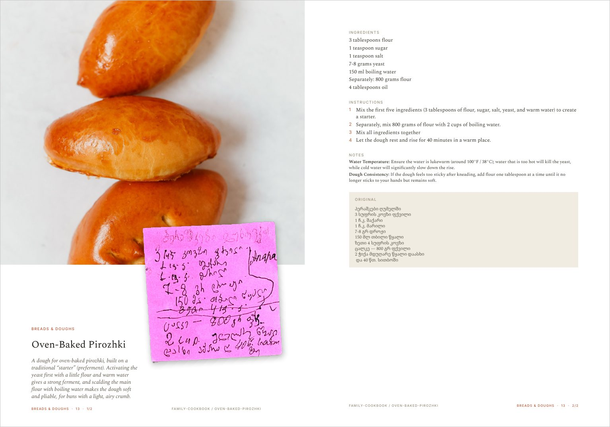

# Family Cookbook: Paul & Nino Wagner

A curated collection of recipes from our family; a gift meant to survive us for our children and theirs. This cookbook preserves traditional recipes from Georgian, Russian, Ukrainian, and Armenian culinary traditions (reflecting the Wagner, Akinian, and Diasamidze families), alongside modern recipes we've gathered from various sources since we got married.

**[Download the cookbook (PDF, 35 MB)](https://github.com/w4gnerd5/family-cookbook/releases/latest/download/cookbook-screen.pdf)** for reading on a phone, tablet or computer.

Printing it? Use the [print edition](https://github.com/w4gnerd5/family-cookbook/releases/latest/download/cookbook-print.pdf) instead: full resolution, A4 with 3mm bleed, about 515 MB. Earlier editions are on the [releases page](https://github.com/w4gnerd5/family-cookbook/releases).



Each recipe opens on a left-hand page with the original handwritten card or printout laid over a photo of the dish. Facing it is the recipe typeset in English, with the original-language text kept underneath. The book holds 75 recipes in seven sections, numbered within each section so that pages added to the binder later never renumber the rest.

## Purpose

This cookbook is a living archive of family recipes and favorites, meant to be:

- **Preserved for future generations.** A lasting gift for our children and beyond.
- **Shared with community.** Friends in Georgian, Russian, Ukrainian and Armenian communities are welcome to fork this repository and add their own family recipes.
- **A growing collection.** Traditional family recipes alongside ones we've found together online.

## Forking for your own family

Friends in the Georgian, Russian, Ukrainian and Armenian communities are welcome to fork this repository, replace the recipes with their own family's, and print their own book. A fork only needs to touch three kinds of file: the recipe `.md` files, `book.yaml` (title, colophon, dedication) and `tokens.yaml` (colors, fonts, sizes). Recipes that might be meaningful to share are welcome back as pull requests.

## Building it yourself

Everything below is for working on the book. To read it, use the download link above.

### What's in the repository

| Path | What it holds |
|---|---|
| `artifacts/` | Raw JPEG scans, the untouched source material |
| `assets/` | The working dataset: one folder per recipe |
| `attic/` | Removed items, kept with their provenance; never feeds a build |
| `print/` | The Typst book (`cookbook.typ`) and its generated data |
| `scripts/` | Build, curation and release tools |
| `book.yaml` | Book-level text: title, colophon, dedication, labels, version |
| `tokens.yaml` | Design tokens shared by the print book and the planned website |
| `RECIPES.md` | Index of every recipe (generated) |
| `CHANGELOG.md` | What changed in each edition |
| `ROADMAP.md` | What's done and what's next |

Each recipe is a folder named after its first scan, for example `assets/georgian/1161/`. It holds exactly one `.md` file, the scan PNGs (`IMG_XXXX.png`, which keep their camera names for provenance) and the dish photo (`dish.jpg`). `assets/georgian/` and `assets/english/` record which scanning run a paper came from; the recipe's language is set in its frontmatter.

### Adding a recipe

1. Put the raw scan in `artifacts/`.
2. Treat the image (remove the background, crop the empty space) and save it as a PNG in a new folder under `assets/`.
3. Translate and format the recipe with the [Culinary Translator & Recipe Historian](https://culinary-translator-recipe-historian-815460826928.us-west1.run.app/). It runs on Gemini, which is unusually faithful when translating Georgian and Russian. Upload the scan or paste the original text, and it returns an English translation, the recipe broken into ingredients, instructions and notes, and some historical or cultural context.
4. Write the companion `.md` file from that output, in the format below, with the original text preserved at the bottom.
5. For a recipe from the web, credit the source.
6. Run the build.

### Companion file format

The frontmatter (title, slug, section, number, scans, photo) is the source of truth for the build; `CLAUDE.md` documents every field. The body looks like this:

```markdown
# Recipe Title

Brief description with historical or cultural context.

## Ingredients

* Ingredient 1

## Instructions

1. Step one

## Notes

* **Label:** detail

### Original Georgian Text

[original text preserved verbatim]
```

Bullets are `*`, always; the build ignores `-` bullets. For recipes with several components, put a bold label such as `**For the Dough:**` above the items rather than a heading. `assets/georgian/1161/IMG_1161.md` and `assets/georgian/1162/IMG_1162.md` are good examples.

### Build

Requirements: Python 3 with Pillow, and [Typst](https://typst.app) 0.15 or later. Fonts are vendored in `assets/fonts/`. Run from the repository root:

```bash
python3 scripts/normalize_md.py assets/*/*/*.md
python3 scripts/md_to_data.py
python3 scripts/make_cards.py
typst compile --root . --font-path assets/fonts print/cookbook.typ print/cookbook.pdf
python3 scripts/build_index.py
python3 scripts/build_credits.py
```

`scripts/build_tokens.py` is needed only after editing `tokens.yaml`.

### Editorial tools

Layout and curation run through three small local web apps. Each is a single Python script that needs nothing beyond the build's own requirements. Each saves straight to files in the repository, so every change shows up in git.

| Tool | Start it | Use it for |
|---|---|---|
| Verso editor | `python3 scripts/verso_editor.py` → localhost:8766 | Placing the scan cards on each recipe's left-hand page |
| Curation dashboard | `python3 scripts/curation_server.py` → localhost:8765 | Inventory, merge decisions, questions for the family, slug audit |
| Photo review | `python3 scripts/photo_review.py` → localhost:8767 | Choosing dish photos, round by round |

**Verso editor.** Pick a recipe and its verso appears with the photo, the cards and the full title block in the real fonts. A card that collides with the title is easy to spot. Drag a card to move it, scroll to tilt it, and shift+scroll to scale it. Buttons bring a card to the top or send it to the bottom. Save writes only the fields you touched into the recipe's `scans:` frontmatter and rebuilds `recipes.json`. "Proof PDF pages" saves, compiles just that recipe, and shows the real pages in an overlay.

Known issue: the editor still assumes a page without bleed. Since the switch to 3mm bleed, its preview sits about 8.5pt off from the printed page. Check placements near an edge with "Proof PDF pages" before trusting them (tracked in `ROADMAP.md`).

**Curation dashboard.** The record of every decision about what is in the book. It tracks which scans belong together, which duplicates went to `attic/`, which section each recipe sits in, and what is still waiting on the family. It is backed by `curation-state.json` and saves on every edit. Rows are never deleted; a finished item is stamped `applied @ <commit>`. `scripts/apply_curation.py` carries out the decisions.

**Photo review.** For each recipe that needs a better dish photo, a round lists candidate images linked to their sources, a note saying what to do with them, and a comment once it's done. Rounds are append-only, in `photo-review.json`. Credits flow from each recipe's `photo_source:` into `CREDITS.md`.

**Art direction by hand.** Everything the verso editor does is plain frontmatter on each entry under `scans:`, and small fixes are often quicker typed in directly:

| Field | Effect |
|---|---|
| `scale` | Size relative to the standard card width (`0.7` for a small note) |
| `tilt` | Rotation in degrees; the default is a random tilt that stays the same from build to build |
| `dx`, `dy` | Nudge in points |
| `z` | `top` or `bottom` of the stack, without moving the card |
| `exposure` | Brightens or darkens a card relative to the automatic correction; `0` turns the correction off |
| `hide` | Keeps the scan in the archive but leaves it off the page |

Small notes ride on top like sticky notes, offset down and to the right so they clear the title. Full-size sheets stay full size and are nudged so their handwriting shows.

**Proof pages without the editor.** Render any pages to PNG to look at a spread or check a page break:

```bash
typst compile --root . --font-path assets/fonts --format png --ppi 110 \
  --pages 14-15 print/cookbook.typ 'page-{p}.png'
```

Add `--input only=<slug>` to render a single recipe without the front matter, as in the example under "Typesetting: title line breaks" below. Look at the result rather than trusting the source: widows, orphans, and a heading stranded at the foot of a page only show up in the render.

### Releasing an edition

Releasing also needs Ghostscript and Poppler (`brew install ghostscript poppler`) and the GitHub CLI.

1. Bump `version:` in `book.yaml`. Versions below 1.0 are pre-publication editions.
2. Add a `## <version> (<date>)` section to `CHANGELOG.md`.
3. Commit and push.
4. Run `scripts/release.sh`.

The script rebuilds the book, makes the 35 MB screen edition, tags `v<version>` and publishes a GitHub Release with both PDFs. The download links in this README always point at the newest release, so they never need editing. `scripts/release.sh --dry-run` builds both editions into `dist/` without publishing anything.

### Card resolution

The scan cards on each verso are baked once into `print/cards/` by
`scripts/make_cards.py` and then embedded in the PDF. They are the bulk of the
file, so their resolution sets how big the book is.

`CARD_MAX_DIM` caps the long side of a baked card in pixels. The default is
1800, which is full quality. Lower it only when something forces you to, and the
only thing that realistically does is a print service's upload limit (Lulu caps
uploads at 500 MB; others sit between 1 and 2 GB).

Measured on this book, 201 pages:

| CARD_MAX_DIM | dpi on the page | cards | whole PDF | what you lose |
|---|---|---|---|---|
| 1800 (default) | 286 | 390 MB | 515 MB | nothing |
| 1400 | 222 | 271 MB | 401 MB | graph-paper grid softens slightly |
| 1200 | 190 | ~168 MB | ~300 MB | grid goes mushy; handwriting still legible |
| 1000 | 158 | ~117 MB | ~250 MB | visibly soft, fine for a markup dummy |

The dpi figure is for a card printed at the full 330pt width. Cards scaled up
per-recipe (`scale:` in frontmatter) land proportionally lower, so a card at
`scale: 1.3` is around 220 dpi even at the 1800 default.

Handwriting stays readable at every setting in that table. The detail that goes
first is the pale graph-paper grid on Zeinab's notebook pages, which is part of
what makes the cards read as her notebook rather than as anonymous paper.

To build small, set the variable for the bake and then compile as usual:

```bash
CARD_MAX_DIM=1000 python3 scripts/make_cards.py
typst compile --root . --font-path assets/fonts print/cookbook.typ print/cookbook.pdf
```

To go back to full quality, bake again without the variable:

```bash
python3 scripts/make_cards.py
```

The cache records the size it was baked at and wipes itself whenever that
changes, so a book can never end up half one resolution and half another. A full
rebake of all cards takes two or three minutes.

The screen edition is not made this way. The release script compresses the
finished print PDF with Ghostscript, so the card cache stays at full quality.

### Typesetting: title line breaks

Recipe titles are set large on the verso page, in a column that fits only a few
words per line. Two things control how a title breaks.

**Automatic:** the build glues the last two words of a title together when the
final word is short (10 characters or fewer), so a title never ends with a lone
stubby word on its own line. Body text gets the same treatment at 7 characters.
Nothing to do; this just happens.

**Manual:** put `|` in the title where you want a line to break. The `|` is
print-only. The table of contents, the index, the printed footer slug, and the
website all get the clean title with the bars stripped out.

Reach for `|` when the automatic break looks wrong. Real example, the
chilaquiles casserole in `assets/georgian/1200/IMG_1200.md`. Written plainly,
the automatic rule bound "Chilaquiles Casserole" and stranded a single word:

```
New Seasons Market
Cheesy
Chilaquiles Casserole
```

Written with explicit breaks:

```yaml
title: New Seasons Market|Cheesy Chilaquiles|Casserole
```

it sets as three balanced lines:

```
New Seasons Market
Cheesy Chilaquiles
Casserole
```

Check the result by proofing that one recipe rather than the whole book:

```bash
typst compile --root . --font-path assets/fonts --input only=<slug> \
  --format png --ppi 110 print/cookbook.typ 'proof-{p}.png'
```

The verso editor's "Proof PDF pages" button does the same thing in the browser
(see "Editorial tools" above).
